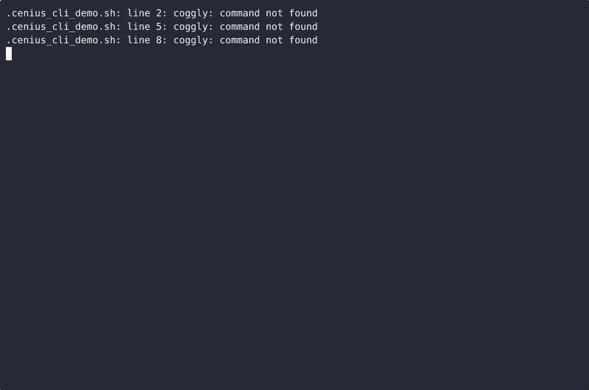
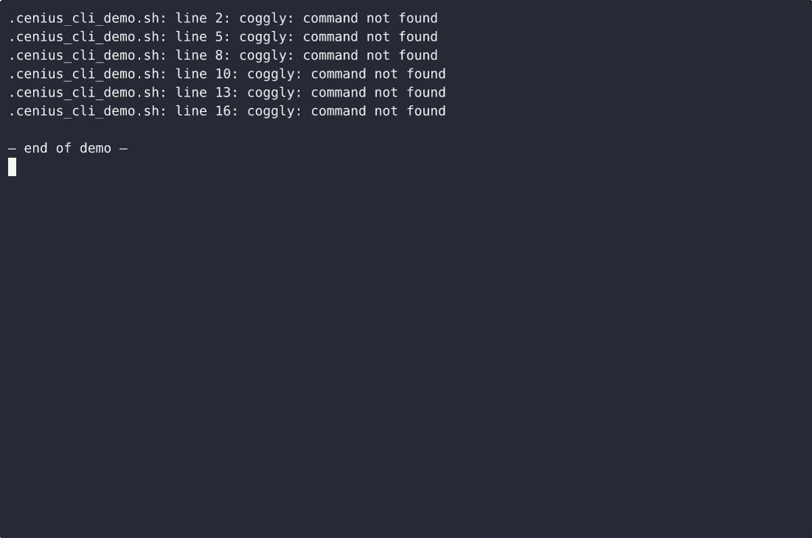

# Coggly — complete Full-stack app command-line tool example app

This repository contains the complete source for **Coggly**, an open-source command-line tool built with Full-stack app. Coggly is a single-file, standard-library-only Python command-line tool for a watch or clock workshop: it logs clock escapement beat error in seconds per day per movement, estimates how much to lengthen or shorten a p…. Everything Coggly needs to run is here — code, seed data, install scripts. Apache-2.0-licensed — use Coggly commercially, self-host it, or [remix Coggly on cenius.ai](https://cenius.ai/marketplace/p/coggly?ref=gh&utm_campaign=coggly-webapp) to make it yours.


[](LICENSE)  [](https://cenius.ai)

[](https://cenius.ai/marketplace/p/coggly?ref=gh&utm_campaign=coggly-webapp)

> **▶ [Open & edit in cenius.ai](https://cenius.ai/marketplace/p/coggly?ref=gh&utm_campaign=coggly-webapp)** — one click to an editable workspace: describe changes in plain English, get an instant preview, one-click deploy and host. Modifications made on the platform come with full rebrand & relicense rights.

_Local clone? See [Quick start](#quick-start) below. cenius.ai is the zero-setup path._

## Demo


▶ **[Full demo walkthrough](https://cenius.ai/marketplace/p/coggly?ref=gh&utm_campaign=coggly-webapp)** — watch it on the project page · [download MP4](.github/media/demo.mp4)

## Screenshots

 

## Quick start

```bash
./install.sh   # installs dependencies + seeds demo data
```

See [`INSTALL.md`](INSTALL.md) for full setup and usage instructions.

## Architecture

Full-stack app project, delivered as a complete runnable codebase (24 files). Top-level layout: `examples/`. Run `./install.sh` once to install packages and populate demo data — the app is ready to use immediately after. Installation walkthrough: [`INSTALL.md`](INSTALL.md).

## Features

- Beat-error log in seconds per day
- Pendulum length correction estimator
- Service history per movement number
- Local JSON store at ~/.coggly.json
- Clean minimal command surface and help

## Usage guide

Every command is one invocation of one process. There is no REPL, no TUI menu
and no daemon: you type a command, you get plain text back, and the data file is
written only if something changed.

Shape of the command line:

```
coggly <group> <command> [options]        groups: beat, pendulum, service
```

`coggly --help` lists the groups; `coggly beat --help` (or `pendulum`,
`service`) lists that group's commands and flags. `--data PATH` may be given
before or after the group name, so a demonstration never touches your real
history.

The transcripts below are real output from this build, produced by running the
commands in the order shown. Only the dates depend on the day you run them.

### Beat-error log — `coggly beat …`

Beat error is always **seconds per day**, positive = running fast. The accepted
window is **−600 … 600 s/day**; anything else is rejected, because a reading
beyond that is not a regulation problem but a fault.

#### Record a reading

```console
$ coggly beat add --movement P-42 --error 4.5
Added reading 0001 - P-42 on 2026-11-24: 4.5 s/day (fast)

$ coggly beat add --movement P-42 --error -2.3 --date 2026-11-02 --note "cold morning in the shop"
Added reading 0002 - P-42 on 2026-11-02: -2.3 s/day (slow) - note: cold morning in the shop

$ coggly beat add --movement W-08 --error 3.3 --note "carriage clock, just cleaned"
Added reading 0003 - W-08 on 2026-11-24: 3.3 s/day (fast) - note: carriage clock, just cleaned
```

_Full guide: [`USAGE.md`](USAGE.md)_

## FAQ

### Can I deploy Coggly on my own infrastructure?

Grab the repo and run `./install.sh` — it handles packages and seed data in one go. After that, [`INSTALL.md`](INSTALL.md) walks you through starting the server. No external accounts required.

### What powers Coggly under the hood?

Powered by Full-stack app. This repo is the real thing — full source, seed data, and all — ready to clone and start up. Highlights include local JSON store at ~/.coggly.json.

### What if I want to add features to Coggly without coding?

[cenius.ai](https://cenius.ai/marketplace/p/coggly?ref=gh&utm_campaign=coggly-webapp) handles the implementation. Tell it what you want in everyday words, pick up the updated build. No coding needed.

### How do I make Coggly my own brand?

Yes. The MIT license lets you remove the original branding and ship under your own name. For a guided approach, [remix it on cenius.ai](https://cenius.ai/marketplace/p/coggly?ref=gh&utm_campaign=coggly-webapp): you get a fresh build with full rebrand and relicense rights.

### Is Coggly free for commercial use?

Yes — Apache-2.0-licensed, so commercial use, modification, and distribution are all permitted. Read the full terms in [LICENSE](LICENSE).

## License & rebranding

Released under the [Apache License 2.0](LICENSE) (© 2026 Cenius AI) — free for personal and commercial use. The Cenius name/logo are trademarks (see NOTICE).

**Need a customized version?** [Remix this app on cenius.ai](https://cenius.ai/marketplace/p/coggly?ref=gh&utm_campaign=coggly-webapp) — modifications made on the platform come with **full rebrand & relicense rights** over your derivative.

## Built with cenius.ai

This entire application — code, design, seeded demo data — was generated on **[cenius.ai](https://cenius.ai)** from a plain-English description.

- 🚀 [Build your own app on cenius.ai](https://cenius.ai)
- 🎛️ [Remix Coggly on the marketplace](https://cenius.ai/marketplace/p/coggly?ref=gh&utm_campaign=coggly-webapp) — open it in a workspace, prompt for changes, and ship your own version.

More open-source apps: [the Cenius-ai catalog](https://github.com/Cenius-ai) · [showcase index](https://github.com/Cenius-ai/showcase)
